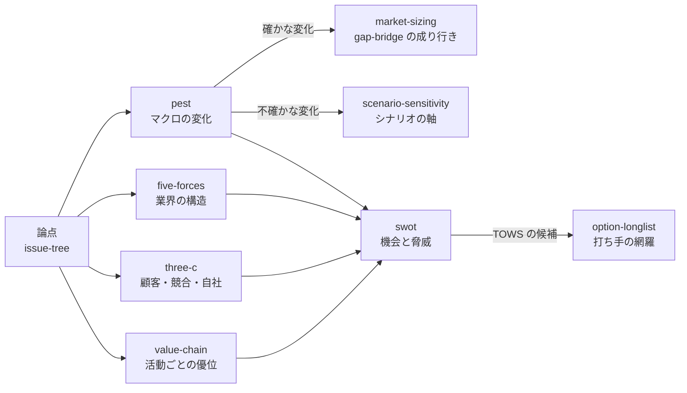

# フレームワークの使い分け

PEST、ファイブフォース、3C、バリューチェーン、SWOT は、どれも「枠」だ。枠は、何を見落としていないかを確かめる道具であって、埋めることが目的ではない。ここでは、それぞれが答える問いと、はしごのどこで使うかをまとめる。

## 何に答えるか

| スキル | 答える問い | 見る範囲 | はしごの段 |
|--------|-----------|---------|-----------|
| [pest](/skills/pest/) | 対象市場の前提を変えるマクロの変化は何か。どれが確かで、どれが不確かか | 外部（マクロ） | 4. 事実 → 5. 成り行き |
| [five-forces](/skills/five-forces/) | この業界（製品 × 地域）は構造的に儲かるか。利益はどこに流れているか | 外部（業界） | 4. 事実 → 6. 打ち手 |
| [three-c](/skills/three-c/) | どの顧客に対して、競合より上手く応えられるか。成功の鍵（KSF）は何か | 顧客・競合・自社 | 4. 事実 → 6. 打ち手 |
| [value-chain](/skills/value-chain/) | 自社はどの活動でコストか差別化の優位を持つか。資本はどの活動に寝ているか | 内部（活動） | 4. 事実 → 6. 打ち手・7. 資本 |
| [swot](/skills/swot/) | 目標に対して、使える強み・埋めるべき弱み・取る機会・避ける脅威は何か。そこからどんな打ち手が出るか | まとめ（内部 × 外部） | 6. 打ち手の手前 |

## つながり

- 外から内へ見る。マクロ（pest）、業界（five-forces）、顧客と競合（three-c）、自社の活動（value-chain）の順に絞ると、比べる相手と基準が先に決まる
- SWOT は最初にやらない。ほかの分析で集めた事実を、目標に照らして並べ直す「まとめ」の枠だ。いきなり SWOT から始めると、根拠のない形容詞が並ぶ
- 全部を毎回やる必要はない。論点ツリーのどの問いに答えるかで選ぶ。答える問いがない枠は埋めない

## お題ごとの重み

| お題 | よく使う枠 | 理由 |
|------|-----------|------|
| A 売上成長 | pest、three-c、swot | 市場の前提（成り行き）と、どのセグメントで勝てるかが鍵になる |
| B 資本効率 | value-chain、swot | 資本がどの活動に寝ているか、何を手放せるかが鍵になる |
| C 新規参入 | five-forces、three-c、pest | 業界が儲かるか、顧客に選ばれるかが、出るか出ないかを決める |
| D M&A | five-forces、value-chain | 買う業界の魅力と、統合で効く活動（シナジー）を見る |

## どの枠にも共通する作法

1. **問いから始める。** 枠の名前ではなく、論点ツリーの問い（Q-xxx）を最初に書く
2. **事実と解釈を分ける。** 数字には台帳の ID を付け、分からない値は — のまま残す。「強い」「大きい」は、比べる相手と根拠を添える
3. **優先順位を付けて絞る。** 項目を並べるだけで終わらない。上位の数件を人が選び、決定を decisions.md に残す
4. **次のスキルに渡す。** 枠の出力は、成り行きの前提、シナリオの軸、打ち手の候補として次の段で使われて初めて意味を持つ

示唆（だから何か）は、ここでも欄として埋めさせない。[先輩質問タイム](/guide/question-time/)で「この表から一言で何が言えるか」を口頭で問う。
