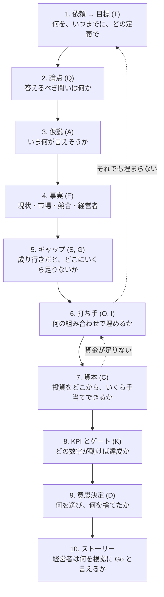
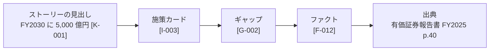

# 抽象から具体への「はしご」

本プロダクトの背骨は、抽象的な依頼を一段ずつ具体化する「はしご」だ。どの段にも、それを担うスキルがある。段と段の間には人が判断するゲートがあり、判断の結果しだいで下の段に戻ってやり直す。主要なゲートの前には、[先輩質問タイム](/guide/question-time/)を置く。

| 段 | 答える問い | 主な成果物 | ID | 主なスキル |
|----|-----------|-----------|----|-----------|
| 1. 依頼 → 目標 | 何を、いつまでに、どの定義で達成したいのか。売上と並べて、資本効率の目標は何か | 目標仕様書 | T | [target-math](/skills/target-math/)、[midterm-plan-reader](/skills/midterm-plan-reader/)、[leadership-lens](/skills/leadership-lens/) |
| 2. 論点 | 答えるべき問いは何か | 論点ツリー、作業計画 | Q | [issue-tree](/skills/issue-tree/)、[workplan](/skills/workplan/) |
| 3. 仮説 | 各論点について、いま何が言えそうか | 仮説一覧 | A | [issue-tree](/skills/issue-tree/) |
| 4. 事実 | 現状、市場、競合、経営者の考えはどうなっているか | 企業カルテ、競合比較、経営者プロファイル | F | [company-financials](/skills/company-financials/)、[financial-analysis](/skills/financial-analysis/)、[growth-decomposition](/skills/growth-decomposition/)、[competitor-benchmark](/skills/competitor-benchmark/)、[market-sizing](/skills/market-sizing/) |
| 5. ギャップ | 成り行きのままだと、どこにいくら足りないか | 成り行き、セグメント別のギャップブリッジ | S、G | [gap-bridge](/skills/gap-bridge/) |
| 6. 打ち手 | 何の組み合わせで埋めるか | 打ち手候補の一覧、施策カード | O、I | [option-longlist](/skills/option-longlist/)、[initiative-sizing](/skills/initiative-sizing/)、[option-evaluation](/skills/option-evaluation/) |
| 7. 資本 | 打ち手に必要な投資を、どこから、いくら手当てできるか | 投資総額と調達余力の対照表 | C | [capital-capacity](/skills/capital-capacity/) |
| 8. KPI とゲート | どの数字が動けば達成か。いつ、何で判断するか | KPI ツリー、事業計画モデル、KPI ロードマップ | K | [kpi-tree](/skills/kpi-tree/)、[business-case-model](/skills/business-case-model/)、[scenario-sensitivity](/skills/scenario-sensitivity/)、[kpi-roadmap](/skills/kpi-roadmap/) |
| 9. 意思決定 | 何を選び、何を捨てたか | 意思決定ログ | D | 人が決める（各スキルが判断の材料を揃えて止まる） |
| 10. ストーリー | 経営者は何を根拠に Go と言えるか | ストーリーライン、ゴーストデッキ | — | [storyline](/skills/storyline/)、[number-audit](/skills/number-audit/) |

## ID で根拠をたどる

ID を使えば、どの数字も、施策カード、ギャップ、ファクト、出典の順にたどって根拠まで戻れる。この経路は、先輩質問タイムで「この数字はどこから来たのか」と聞かれたときに、ジュニアが自分でたどる道でもある。

すべての数字は `facts/facts.csv` の台帳に 1 行ずつ載り、ほかの成果物は値に ID を添えて参照する。書き方の決まりは[共通の決まり](/guide/conventions/)にある。点検は [number-audit](/skills/number-audit/) が機械的に行う。
