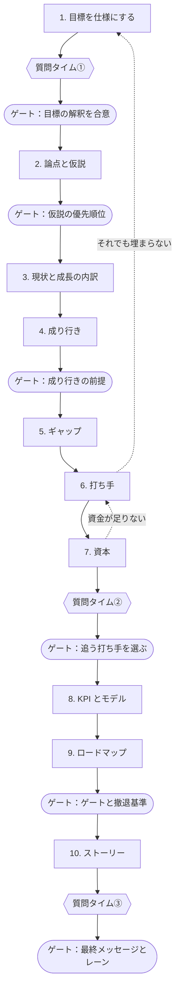

# お題A：売上成長

> 会社と数値はすべて架空で、説明用の仮置き。最後まで通した成果物は[見本案件：北辰工業](../cases/hokushin/README.md)にある。

## 依頼

架空の B2B 部品メーカー「北辰工業」（売上 2,000 億円、3 セグメント）の社長が、次の中計で「売上 5,000 億円」を掲げたいと考えている。「達成する道筋を描いてほしい」。

## 難所

- 期限と定義によって、難易度がまったく変わる
- シェア獲得に頼りすぎた計画になりやすい
- 打ち手を積み上げるうちに、資金の手当てを忘れる

## ワークフロー

| ステップ | 答える問い | スキル | ゲート（人が決める） | 時期 |
|---------|-----------|--------|-------------------|------|
| 1. 目標を仕様にする | 何を、いつまでに、どの定義で。資本効率の目標は何か | [target-math](../skills/target-math/README.md)、[midterm-plan-reader](../skills/midterm-plan-reader/README.md)、[leadership-lens](../skills/leadership-lens/README.md) | 目標の解釈を合意する（前に質問タイム①） | 1〜2 日目 |
| 2. 論点と仮説 | 答えるべき問いは何か | [issue-tree](../skills/issue-tree/README.md)、[workplan](../skills/workplan/README.md) | 検証する仮説の優先順位を決める | 2〜3 日目 |
| 3. 現状と成長の内訳 | 何で伸びてきたのか | [company-financials](../skills/company-financials/README.md)、[financial-analysis](../skills/financial-analysis/README.md)、[growth-decomposition](../skills/growth-decomposition/README.md)、[competitor-benchmark](../skills/competitor-benchmark/README.md) | — | 1 週目 |
| 4. 成り行き | 市場はどれだけ伸びるか | [market-sizing](../skills/market-sizing/README.md) | 成り行きの前提を確定する | 1 週目 |
| 5. ギャップ | どこにいくら足りないか | [gap-bridge](../skills/gap-bridge/README.md) | — | 1 週目末 |
| 6. 打ち手 | 何で埋めるか | [option-longlist](../skills/option-longlist/README.md)、[initiative-sizing](../skills/initiative-sizing/README.md)、[option-evaluation](../skills/option-evaluation/README.md) | — | 2 週目前半 |
| 7. 資本 | 打ち手の投資を手当てできるか | [capital-capacity](../skills/capital-capacity/README.md) | 追う打ち手を選ぶ（前に質問タイム②） | 2 週目前半 |
| 8. KPI とモデル | 何が動けば達成か | [kpi-tree](../skills/kpi-tree/README.md)、[business-case-model](../skills/business-case-model/README.md)、[scenario-sensitivity](../skills/scenario-sensitivity/README.md) | — | 2 週目前半 |
| 9. ロードマップ | いつ、何で判断するか | [kpi-roadmap](../skills/kpi-roadmap/README.md) | ゲートと撤退基準を確定する | 2 週目後半 |
| 10. ストーリー | 経営者は何を根拠に Go と言えるか | [storyline](../skills/storyline/README.md)、[number-audit](../skills/number-audit/README.md) | 最終メッセージとレーンを確定する（前に質問タイム③） | 2 週目後半 |

資本の段が、売上の打ち手と資金の手当てを突き合わせる関所になる。

## 数字の例

[target-math](../skills/target-math/README.md) と [gap-bridge](../skills/gap-bridge/README.md) のスクリプトで計算した値。

| 期限 | 必要な年率 |
|------|-----------|
| 5 年（FY2030） | 20.1% |
| 7 年（FY2032） | 14.0% |
| 10 年（FY2035） | 9.6% |

市場成長を年 5% と置くと、5 年後の成り行きは約 2,553 億円で、ギャップは約 2,447 億円になる。

このギャップのうち 800 億円をシェア獲得に載せる計画だとする。市場成長に上乗せして、年 5.9 ポイント前後のシェア由来成長が 5 年続く計算だ。McKinsey の分析では、シェア獲得だけで年 5% 超の成長を 10 年平均で得た企業は 13% だった。期間の長さは違うが、gap-bridge はここに赤旗を立てる。平均的な 0.8 ポイントなら、5 年で約 99 億円にとどまるからだ。

赤旗は「無理です」と言うためのものではない。二本目のレーンで、M&A や市場の選び直しといった別の道筋を示す根拠に使う。資本のステップで資金が足りなければ打ち手に戻り、それでもギャップが埋まらなければ、目標の期限や定義を経営者と相談し直す。

## 参考にするベースレート

| 事実 | 出典 |
|------|------|
| 中計最終年度を迎えた企業のうち、売上高目標の達成は 53%（27/51 社）、営業利益目標は 35%（15/43 社）。古く小さな標本 | いちよし経済研究所（MONEY PLUS、2019 年 7 月） |
| 売上 20〜50 億ドルで始まった米国上場企業の 5 年売上成長は、年率平均 7.0%、標準偏差 10.6%。売上 2,000 億円はこの参照クラスより小さいので、使うときは選び直す | Mauboussin & Callahan「Bayes and Base Rates」（2026 年 2 月） |
| 平均年 8.7% 成長の内訳は、市場成長 5.4%、M&A 約 2.5%、シェア獲得 0.8% | McKinsey（2017 年 8 月） |
